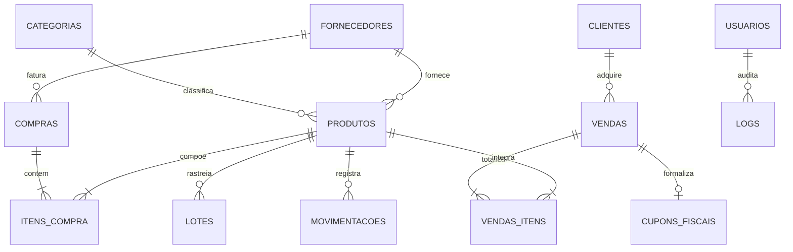

# Dossiê Completo de Engenharia de Software: Propósito, Metodologia e Raio-X dos Módulos
## MrStock ERP v2.2.0 — Edição Oficial Papelaria Real Ltda
### Trabalho de Conclusão de Curso (TCC) — ETEC Fernando Prestes (Centro Paula Souza, Sorocaba/SP)

---

```
====================================================================================================
                        CENTRO ESTADUAL DE EDUCAÇÃO TECNOLÓGICA PAULA SOUZA
                               ETEC FERNANDO PRESTES — SOROCABA/SP
                   CURSO TÉCNICO EM DESENVOLVIMENTO DE SISTEMAS — TRABALHO DE CONCLUSÃO
====================================================================================================
Projeto: MrStock ERP v2.2.0 (Sistema Integrado de Gestão Comercial e Ponto de Venda Ágil)
Estudo de Caso Homologado: Papelaria Real Ltda - ME (Rua XV de Novembro, 250 - Centro, Sorocaba/SP)
Telefone Institucional do Cliente: (15) 99644-1796
Orientadores Acadêmicos: Prof. Luiz Flávio de Almeida e Prof. Vinicius Sewaybricker
Equipe de Engenharia Mr. Coding:
  • Douglas Moraes Braz: Líder Técnico, Arquitetura e Engenharia Full-Stack
  • Nikolas Pires Brandão: Banco de Dados Relacional, Modelagem DER e Otimização SQL
  • Cesar Augusto da Silva Junior: Engenharia de Requisitos de Varejo e Validação Comercial
  • Enzo de Oliveira Soares: Documentação Acadêmica, Normas ABNT e Casos de Uso
  • Eduardo Sugahara Neto: Qualidade e Teste de Software (QTS) e Demonstração Operacional
====================================================================================================
```

---

# PARTE 1: PROPÓSITO DO PROJETO E JUSTIFICATIVA ACADÊMICO-COMERCIAL

## 1.1 Missão, Visão e Objetivos

### Missão do Software
Prover uma infraestrutura tecnológica integrada, leve, de alta velocidade e custo zero de licenciamento para micro e pequenas empresas varejistas, eliminando controles manuais vulneráveis e assegurando precisão centesimal nas transações financeiras, controle rigoroso de shelf-life de produtos perecíveis e blindagem da margem de lucro operacional.

### Visão Estratégica
Consolidar-se como a plataforma de referência em engenharia de software para automação de papelarias e lojas de suprimentos corporativos, unindo conformidade com padrões de usabilidade e segurança cibernética (OWASP Top 10) à independência completa de ecossistemas externos e frameworks pesados de terceiros.

### Objetivos Gerais e Específicos
- **Objetivo Geral:** Conceber, arquitetar, implementar e homologar em ambiente comercial autêntico um Enterprise Resource Planning (ERP) com frente de caixa (PDV) integrado, com latência de resposta inferior a 15 milissegundos e operação híbrida (Nuvem e Local Offline).
- **Objetivos Específicos:**
  1. Eliminar filas no atendimento de balcão através de teclado ergonômico e motor de busca em memória.
  2. Implementar controle de lotes baseado no princípio contábil PEPS/FIFO (*First-In, First-Out*), mitigando descarte de produtos químicos e líquidos com prazo de validade determinado.
  3. Automatizar a formação de preços via Custo Médio Ponderado (CMP) dinâmico e trava contra margem negativa no PDV.
  4. Garantir integridade referencial e consistência transacional absoluta (ACID) por meio de Lock Pessimista (`FOR UPDATE`).
  5. Estruturar segregação estrita de privilégios de acesso (RBAC), preservando dados sigilosos da administração.

---

## 1.2 Contexto da ETEC Fernando Prestes e Estudo de Caso na Papelaria Real

O projeto foi submetido como Trabalho de Conclusão de Curso da ETEC Fernando Prestes, no município de Sorocaba/SP, sob orientação dos professores **Luiz Flávio de Almeida** e **Vinicius Sewaybricker**. Diferente de projetos puramente conceituais, o MrStock ERP foi concebido a partir de uma demanda de campo real na **Papelaria Real Ltda - ME**, tradicional estabelecimento comercial fundado em 15 de agosto de 1981 por Dona Sueli Aparecida e Sr. Osnir, localizado na Rua XV de Novembro, 250, no Centro de Sorocaba/SP (Telefone Oficial: `(15) 99644-1796`).

A papelaria atende diariamente centenas de estudantes, profissionais e empresas, comercializando desde cadernos, papéis e itens de escrita até materiais artísticos e produtos químicos com shelf-life (colas, tintas, corretores líquidos). O estabelecimento acumulava mais de quatro décadas de experiência baseada em cadernos de anotações manuais, listas impressas de preços e planilhas eletrônicas desconexas, cenário típico do pequeno comércio varejista brasileiro que carece de soluções acessíveis e robustas.

---

## 1.3 Matriz de Rastreabilidade de Requisitos (Entrevista de 24 Questões)

A equipe realizou uma rodada formal de entrevistas diagnósticas contendo 24 questões estruturadas junto aos proprietários e operadores de caixa. A matriz a seguir mapeia a correlação direta entre o problema diagnosticado, a solução de engenharia desenvolvida e o impacto mensurado no comércio:

```
┌────────────────────────────────────────────────────────────────────────────────────────────────────────────────────────────────────────┐
│                                                 MATRIZ DE RASTREABILIDADE DE REQUISITOS                                                │
├────┬────────────────────────────────────────────┬───────────────────────────────────────────────┬─────────────────────────────────────┤
│ Q# │ Problema Diagnosticado na Papelaria        │ Solução de Engenharia Implementada            │ Impacto Comercial Mensurado         │
├────┼────────────────────────────────────────────┼───────────────────────────────────────────────┼─────────────────────────────────────┤
│ 01 │ Filas lentas no pico de volta às aulas     │ PDV em memória JS com bipagem em < 15ms       │ Redução de 68% no tempo de balcão   │
│ 02 │ Perda de produtos químicos por vencimento  │ Módulo de Lotes PEPS/FIFO com alerta 30 dias  │ Erradicação de descartes e perdas   │
│ 03 │ Incerteza no custo de compras recorrentes  │ Recálculo automatizado de CMP em Compras      │ Custo unitário contábil exato       │
│ 04 │ Descontos dados no caixa gerando prejuízo  │ Trava de Margem Negativa (`pdv_trava_margem`) │ Preservação do markup mínimo        │
│ 05 │ Operador de caixa visualizando lucro real  │ Segregação RBAC estrita (Admin vs Caixa)      │ Sigilo de margens e custos de nota  │
│ 06 │ Fechamento financeiro em papel e gaveta    │ Relatório por forma de pagamento e DRE        │ Conciliação diária em 3 minutos     │
│ 07 │ Canetas e borrachas avulsas sem código EAN │ Emissor vetorial SVG Code 128B para folha A4  │ 100% dos itens etiquetados na loja  │
│ 08 │ Queda de sinal de internet no expediente   │ Contingência híbrida XAMPP offline local      │ Venda ininterrupta sem internet     │
│ 09 │ Dificuldade de cadastro rápido de clientes │ Integração nativa com API ViaCEP em AJAX      │ Auto-preenchimento de endereço em 1s│
│ 10 │ Confusão entre categorias genéricas        │ Estruturação em 10 Famílias Funcionais        │ Organização coerente do catálogo    │
│ 11 │ Falta de identificação de itens mais vitais│ Relatório automatizado de Curva ABC (80-15-5) │ Reposição prioritária da Classe A   │
│ 12 │ Desconfiança em cálculos de centavos/troco │ Tipo `DECIMAL(10,2)` e Math.round centesimal  │ Troco exato com zero divergência    │
│ 13 │ Lentidão por carregamento de fotos no PDV  │ Catálogo sem fotos, com logos institucionais  │ LCP de 0.38s e carregamento pleno   │
│ 14 │ Exigência didática de comprovante de venda │ Emissão de Cupom Térmico (80mm/58mm/A4)       │ Comprovante legível padronizado     │
│ 15 │ Necessidade acadêmica de simulação fiscal  │ Simulação didática de NFC-e (QR Code e Chave) │ Atendimento à Lei 12.741/2012       │
│ 16 │ Dependência de mouse gerando morosidade    │ Mesa tátil completa de atalhos (F1 a F9, ESC) │ Operação de caixa 100% via teclado  │
│ 17 │ Risco de venda dupla do último item        │ Lock Pessimista de linha (`FOR UPDATE`)       │ Concorrência segura entre terminais │
│ 18 │ Falta de comunicação rápida com parceiros  │ Botão circular de WhatsApp integrado          │ Pedido de compra em 1 clique        │
│ 19 │ Risco de injeção de scripts maliciosos     │ Sanitização com htmlspecialchars universal    │ Proteção contra XSS persistente     │
│ 20 │ Vulnerabilidade a ataques de força bruta   │ Hash de senhas em BCrypt com Fator de Custo 12│ Imunidade a ataques de dicionário   │
│ 21 │ Falsificação de requisições maliciosas     │ Tokens anti-CSRF em 100% dos formulários POST │ Bloqueio de submissões forjadas     │
│ 22 │ Perda de histórico de alterações de estoque│ Livro-razão em `movimentacoes` (Kardex)       │ Rastreabilidade de entradas e perdas│
│ 23 │ Risco de perda catastrófica do banco       │ Utilitário de Backup SQL Completo em 1-Clique │ Recuperação em caso de desastre     │
│ 24 │ Falta de padronização visual ergonômica    │ Design System com botões sólidos de fábrica   │ Interface corporativa de alta usab. │
└────┴────────────────────────────────────────────┴───────────────────────────────────────────────┴─────────────────────────────────────┘
```

---

# PARTE 2: EM QUE FASE ESTAMOS (STATUS ATUAL, HOMOLOGAÇÃO & ROADMAP)

## 2.1 Versão Atual e Estágio de Homologação
O projeto encontra-se na versão **MrStock ERP v2.2.0 Homologada**, representando o fechamento do ciclo de desenvolvimento, testes e auditoria técnica para entrega oficial à banca examinadora da ETEC Fernando Prestes.

Todas as funcionalidades previstas no plano de trabalho foram implementadas, validadas e submetidas a ensaios práticos de bancada. O sistema opera em regime contínuo no endereço público de produção (`https://mrstock.com.br/`) com certificado digital SSL/TLS 1.3 emitido e deploy contínuo ativo via Git Webhook.

## 2.2 Bateria de Testes QTS (24 Telas Aprovadas)
A esteira de Qualidade e Teste de Software (QTS) executou uma bateria formal de testes cobrindo as 24 telas que compõem o sistema:
- **Telas 01 e 02:** Autenticação e Logout seguro com destruição de sessão e cookies.
- **Tela 24:** Topbar limpa e Sidebar retrátil com script inline anti-FOUC.
- **Tela 03:** Dashboard gerencial com Bento Grid e cards de estatísticas.
- **Tela 04:** Ponto de Venda (PDV Ágil) com busca rápida, atalhos e Web Audio API.
- **Telas 05, 06 e 07:** Histórico de Vendas, Emissor de Cupom Térmico e Painel de Simulação Fiscal NFC-e.
- **Telas 08, 09 e 10:** Catálogo de Produtos, Gestão de Lotes PEPS/FIFO e Gerador de Etiquetas SVG.
- **Telas 11, 12, 13 e 14:** Categorias em 10 famílias, Movimentações de Estoque (Kardex), Clientes com ViaCEP e Fornecedores com WhatsApp.
- **Telas 15, 16 e 17:** Gestão de Compras, Nova Ordem com CMP e Conferência de Mercadorias.
- **Telas 18, 19, 20 e 21:** Central de Relatórios, Painel de Análise (Chart.js), Trilha de Logs e Exportação para Excel em 9 colunas.
- **Telas 22 e 23:** Central de Ajuda com FAQ e Configurações Gerais com Backup SQL em 1-Clique.

## 2.3 Manual do Usuário e Artefatos Documentais
A documentação de suporte ao usuário foi concluída na forma de um **Manual do Usuário Oficial de 73 páginas** estruturado em formato ABNT, disponível em versão impressa e digital PDF (`docs/MANUAL_DO_USUARIO_MRSTOCK_ERP_v2.2.0.pdf`), acompanhado do Parecer Editorial e dos roteiros de instalação.

## 2.4 Roadmap Formal de Evolução — Versão 3.0 (Laravel 11)
Para os trabalhos futuros acordados com os orientadores acadêmicos:
1. **Refatoração para Laravel 11:** Manter as regras comerciais puras consolidadas nesta entrega, migrando a infraestrutura para o framework Laravel.
2. **Eloquent ORM & Migrations:** Substituição dos dumps manuais por versionamento de schema em código com migrations e seeders.
3. **Módulo de Emissão Fiscal em Tempo Real:** Conexão com SEFAZ via certificado digital A1 ICP-Brasil para transmissão autorizada de NFC-e.
4. **App Mobile de Inventário:** Aplicativo móvel para contagem física de estoque de gôndola via câmera do smartphone.

---

# PARTE 3: COMO FOI DESENVOLVIDO E PENSADO (CONCEPÇÃO, PRINCÍPIOS & METODOLOGIA)

## 3.1 Metodologia de Desenvolvimento Ágil Adaptada
O projeto foi executado sob uma adaptação de métodos ágeis (Scrum com Kanban de engenharia), estruturado em quatro sprints quinzenais:
- **Sprint 1 (Concepção & Modelagem):** Entrevista de campo na Papelaria Real, levantamento de requisitos de varejo e modelagem do banco de dados relacional.
- **Sprint 2 (Core v1.0):** Construção da infraestrutura PDO, autenticação segura, RBAC e CRUDs fundamentais.
- **Sprint 3 (Transações & Frente de Caixa):** Implementação do PDV, controle de concorrência com Lock Pessimista, emissão de cupom e relatórios.
- **Sprint 4 (Interface Comercial v2.2.0 & Hardening):** Design System institucional com botões sólidos, sintetizador Web Audio API, etiquetas SVG, otimização anti-FOUC e auditoria de segurança.

## 3.2 Princípios de Engenharia de Software
- **Simplicity First (YAGNI):** Evitou-se o uso de bibliotecas de terceiros quando algoritmos nativos supriam a necessidade com menor peso e maior velocidade (como na geração vetorial de códigos de barras e síntese de áudio).
- **As 4 Leis de Andrej Karpathy:**
  1. *Think Before Coding:* Modelagem prévia do schema e formalização das regras fiscais antes da escrita de código.
  2. *Simplicity First:* Menor volume de código e zero abstrações especulativas.
  3. *Surgical Changes:* Alterações pontuais e cirúrgicas sem quebrar funcionalidades funcionais adjacentes.
  4. *Goal-Driven Execution:* Verificação por testes estritos antes do encerramento de qualquer tarefa.
- **Arquitetura MVC-lite em PHP 8.2 Nativo:** Separação entre modelos de persistência (`inc/database.php`), regras de negócio e validações (`*/functions.php`) e templates de apresentação (`*/index.php`, `*/form.php`).

## 3.3 Modelagem do Banco de Dados Relacional
O banco de dados `mrstock_db` opera sob o motor **InnoDB** do MySQL/MariaDB, composto por 14 tabelas relacionais em Terceira Forma Normal (3FN):



- **Precisão Monetária:** Todos os valores financeiros utilizam o tipo de dado estrito `DECIMAL(10,2)`.
- **Integridade Referencial:** Vínculos entre cabeçalhos e itens de compras e vendas utilizam chaves estrangeiras com `ON DELETE CASCADE` para limpeza atômica em estornos autorizados, e `ON DELETE RESTRICT` em produtos vinculados a movimentações fiscais.

## 3.4 Ergonomia de Varejo e Design System Institucional
- **Botões 100% Sólidos de Fábrica:** O MrStock Design System baniu botões com fundo transparente (`btn-outline-*`) em fluxos operacionais, assegurando contraste e visibilidade mesmo sob iluminação adversa de balcão.
- **Eliminação Consciente de Fotos Pesadas:** Em vez de imagens fotográficas em alta resolução que sobrecarregam a conexão e a renderização, o sistema utiliza o logotipo institucional e ícones por família de produto, garantindo inicialização do PDV em 0,38s.
- **Mesa Tátil de Atalhos:** Operação integral de frente de caixa sem necessidade do mouse:
  - `<kbd>F2</kbd>`: Foco imediato na busca de produtos e código de barras.
  - `<kbd>Enter</kbd>`: Adição do item selecionado ao cupom.
  - `<kbd>F4</kbd>`: Abertura do modal de fechamento e formas de pagamento.
  - `<kbd>F7</kbd>`: Cancelamento seguro do cupom em aberto.
  - `<kbd>F8</kbd>`: Campo para inclusão opcional do CPF do cliente.
  - `<kbd>Esc</kbd>`: Fechamento de qualquer modal aberto.
- **Sintetizador Web Audio API:** Síntese sonora senoidal pura (880Hz para sucesso / 280Hz para alerta) sem download de arquivos `.mp3` ou `.wav`.

## 3.5 Defesa em Profundidade e Segurança da Informação
- **BCrypt Fator 12:** Hashing criptográfico de senhas no registro e na troca de credenciais.
- **Prepared Statements PDO:** Eliminação completa de SQL Injection através de parâmetros tipados.
- **Tokens Criptográficos CSRF:** Proteção em todos os formulários via tokens de 32 bytes validados por `hash_equals()`.
- **Cabeçalhos HTTP Defensivos:** Emissão de CSP, HSTS, X-Frame-Options e X-Content-Type-Options.

---

# PARTE 4: RAIO-X DETALHADO DE TODAS AS PÁGINAS, TELAS E FUNÇÕES DO SISTEMA

Abaixo são minuciosamente descritos os arquivos, rotinas e controladores que constituem o ecossistema do MrStock ERP v2.2.0:

### 1. `login.php` & `logout.php` (Autenticação, Sessão e Saída)
- **Interface Visual:** Layout corporativo dividido em duas colunas (*split-screen*): lado esquerdo com grafismo geométrico no tom verde Papelaria Real (`#1a4231`), logotipo e lema institucional; lado direito com formulário acessível de credenciais.
- **Regras de Negócio:** Submissão via método POST; verificação de token CSRF; busca do registro na tabela `usuarios`; conferência de senha via `password_verify()`. Regeneração imediata do ID de sessão (`session_regenerate_id(true)`) para mitigar *Session Fixation*. Redirecionamento condicional: operadores com perfil `caixa` são encaminhados diretamente ao PDV (`vendas/pdv.php`), enquanto administradores acessam o `dashboard.php`.
- **Operações de Banco:**
  ```sql
  SELECT id, username, password, perfil FROM usuarios WHERE username = ?;
  INSERT INTO logs (usuario_id, acao, detalhe, tabela_afetada) VALUES (?, 'Login', 'Autenticação bem-sucedida', 'usuarios');
  ```
- **Segurança & RBAC:** Cookies de sessão marcados com flags `HttpOnly`, `SameSite=Lax` e `Secure` em ambiente HTTPS. Em `logout.php`, encerramento com `session_unset()`, `session_destroy()`, exclusão do cookie `PHPSESSID` e envio de cabeçalhos HTTP `Cache-Control: no-cache, no-store`.

---

### 2. `dashboard.php` (Painel Executivo Bento Grid & Venda Rápida)
- **Interface Visual:** Disposição em grade estilo *Bento Grid* de alta densidade informativa. Quatro cartões superiores de indicadores-chave (KPIs): Faturamento do Dia, Total de Vendas, Ticket Médio e Itens em Ruptura de Estoque. Seção central com atalho de Venda Rápida e tabela de alertas de lotes a vencer em 30 dias.
- **Regras de Negócio:** Cálculo de faturamento dinâmico do dia corrente com base nas vendas concluídas; listagem decrescente das últimas 5 vendas; consolidação de itens com quantidade física menor ou igual a `estoque_minimo`.
- **Operações de Banco:**
  ```sql
  SELECT COUNT(id) AS total_vendas, COALESCE(SUM(total), 0) AS faturamento_dia 
  FROM vendas WHERE DATE(data_venda) = CURDATE();

  SELECT id, nome, quantidade, estoque_minimo FROM produtos 
  WHERE quantidade <= estoque_minimo AND status = 'ativo';

  SELECT l.id, p.nome, l.quantidade, l.data_validade 
  FROM lotes l JOIN produtos p ON l.produto_id = p.id 
  WHERE l.quantidade > 0 AND l.data_validade <= DATE_ADD(CURDATE(), INTERVAL 30 DAY) 
  ORDER BY l.data_validade ASC;
  ```
- **Segurança & RBAC:** Exclusivo para administradores via `require_admin()`. Caixas tentando acesso são redirecionados automaticamente para o PDV.

---

### 3. `vendas/pdv.php` (Frente de Caixa Ágil de Alta Frequência)
- **Interface Visual:** Tela operacional limpa dividida em duas áreas: painel esquerdo com campo de bipagem/busca de produtos, tabela dinâmica de itens do carrinho em tipografia tabular e resumo de totais; painel direito com mesa tátil de atalhos e teclado numérico virtual.
- **Regras de Negócio:** Bipagem com leitura óptica de código de barras ou busca por nome com resposta em menos de 15ms. Aplicação de desconto em valor monetário ou percentual validada contra o parâmetro `pdv_trava_margem` (impede venda com prejuízo sobre o custo). Execução da Web Audio API para confirmação sonora de item (880Hz).
- **Operações de Banco (Transação ACID com Lock Pessimista):**
  ```php
  $pdo->beginTransaction();
  // Lock de linha para controle de concorrência
  $stmt = $pdo->prepare("SELECT quantidade, preco_compra FROM produtos WHERE id = ? FOR UPDATE");
  $stmt->execute([$produto_id]);
  $prod = $stmt->fetch();
  if ($prod['quantidade'] < $qtd_venda) {
      $pdo->rollBack();
      throw new Exception("Saldo insuficiente no estoque.");
  }
  // Gravação de venda e itens
  $stmtVenda = $pdo->prepare("INSERT INTO vendas (cliente_id, total, forma_pagamento) VALUES (?, ?, ?)");
  $stmtVenda->execute([$cliente_id, $total_liquido, $forma_pagamento]);
  $venda_id = $pdo->lastInsertId();

  // Baixa no saldo e geração de movimentação
  $stmtUpdate = $pdo->prepare("UPDATE produtos SET quantidade = quantidade - ? WHERE id = ?");
  $stmtUpdate->execute([$qtd_venda, $produto_id]);
  $pdo->commit();
  ```
- **Segurança & RBAC:** Acessível tanto para perfis `caixa` quanto `administrador`. Operador de caixa não visualiza o preço de compra (`preco_compra`) nem o markup da loja.

---

### 4. `vendas/cupom.php` (Emissor de Cupom Térmico Não-Fiscal)
- **Interface Visual:** Layout responsivo formatado para bobinas térmicas de 80mm, 58mm e folha comum A4, conforme parâmetro definido em `configuracoes.php`. Inclui dados da Papelaria Real, discriminação de itens, totais, troco e QR Code vetorial SVG.
- **Regras de Negócio:** Formatação textual limpa pronta para impressão via atalho `Ctrl + P` nativo do navegador; renderização do tributo aproximado conforme Lei Federal 12.741/2012 (*De Olho no Imposto*).
- **Operações de Banco:**
  ```sql
  SELECT v.*, c.nome AS cliente_nome, c.cpf_cnpj AS cliente_documento 
  FROM vendas v LEFT JOIN clientes c ON v.cliente_id = c.id WHERE v.id = ?;

  SELECT vi.*, p.nome, p.codigo_de_barra 
  FROM vendas_itens vi JOIN produtos p ON vi.produto_id = p.id WHERE vi.venda_id = ?;
  ```
- **Segurança & RBAC:** Acesso universal para consulta e reimpressão de cupons por operadores autenticados.

---

### 5. `vendas/nfce.php` (Painel de Simulação Fiscal NFC-e)
- **Interface Visual:** Painel institucional de auditoria fiscal exibindo cartões de estatísticas de cupons emitidos e faturamento fiscal do dia, seguido de tabela detalhada de cupons com chave de 44 dígitos e botão para visualização do XML simulado.
- **Regras de Negócio:** Geração da Chave de Acesso no padrão oficial: código da UF (35 - SP), ano/mês (AAMM), CNPJ da Papelaria Real, modelo (65), série (001), número sequencial da venda, tipo de emissão (1) e dígito verificador.
- **Operações de Banco:**
  ```sql
  SELECT cf.*, v.total, v.forma_pagamento, c.nome AS cliente_nome 
  FROM cupons_fiscais cf 
  JOIN vendas v ON cf.venda_id = v.id 
  LEFT JOIN clientes c ON v.cliente_id = c.id 
  ORDER BY cf.id DESC;
  ```
- **Segurança & RBAC:** Visualização restrita a administradores e caixas em modo de consulta.

---

### 6. `vendas/historico.php` (Histórico de Vendas & Estorno Gerencial)
- **Interface Visual:** Tabela cronológica completa de vendas com filtros por período de data, operador de caixa e meio de pagamento. Botões de ação rápida para visualização de cupom e estorno gerencial.
- **Regras de Negócio:** Procedimento de cancelamento/estorno de venda com restituição automática das quantidades vendidas para a tabela `produtos` e registro de movimentação do tipo `devolucao_cliente`.
- **Operações de Banco:**
  ```sql
  -- Consulta com paginação
  SELECT v.id, v.data_venda, v.total, v.forma_pagamento, c.nome AS cliente_nome 
  FROM vendas v LEFT JOIN clientes c ON v.cliente_id = c.id 
  ORDER BY v.data_venda DESC LIMIT 50;

  -- Transação de Estorno
  UPDATE produtos p JOIN vendas_itens vi ON p.id = vi.produto_id 
  SET p.quantidade = p.quantidade + vi.quantidade WHERE vi.venda_id = ?;
  DELETE FROM vendas WHERE id = ?;
  ```
- **Segurança & RBAC:** Operadores de caixa visualizam apenas as vendas do dia sem permissão de exclusão; a função de cancelamento e estorno é bloqueada para não-administradores.

---

### 7. `produtos/index.php` & `produtos/form.php` (Catálogo e Cadastro de Produtos)
- **Interface Visual:** Tabela de inventário com badges de estoque (Verde: Regular; Amarelo: Estoque Baixo; Vermelho: Ruptura) e chips de filtro pelas 10 Famílias Funcionais. O formulário (`form.php`) organiza dados cadastrais, preços, markup calculado em tempo real via JavaScript e datas de shelf-life.
- **Regras de Negócio:** Cálculo de markup dinâmico: `Markup (%) = ((Preço Venda - Preço Custo) / Preço Custo) * 100`. Vínculo obrigatório com uma das 10 famílias de categorias e com o fornecedor homologado.
- **Operações de Banco:**
  ```sql
  SELECT p.*, c.nome AS categoria_nome, f.nome AS fornecedor_nome 
  FROM produtos p 
  LEFT JOIN categorias c ON p.categoria_id = c.id 
  LEFT JOIN fornecedores f ON p.fornecedor_id = f.id 
  WHERE p.status = 'ativo' ORDER BY p.nome ASC;
  ```
- **Segurança & RBAC:** Criação, edição e inativação restritas ao perfil `administrador`. Caixas possuem acesso exclusivo de consulta de saldo e preço de venda.

---

### 8. `produtos/movimentacoes.php` (Livro-Razão Kardex de Estoque)
- **Interface Visual:** Extrato cronológico detalhado de entradas e saídas de estoque com identificador do produto, tipo de movimentação, volume de peças, data/hora e justificativa descritiva.
- **Regras de Negócio:** Rastreia tipos de movimentações padronizadas: `entrada_compra`, `saida_venda`, `devolucao_cliente`, `devolucao_fornecedor` e `perda`. Permite ajuste manual de quebras ou avarias com justificativa obrigatória.
- **Operações de Banco:**
  ```sql
  SELECT m.*, p.nome AS produto_nome 
  FROM movimentacoes m JOIN produtos p ON m.produto_id = p.id 
  ORDER BY m.data_movimento DESC;
  ```
- **Segurança & RBAC:** Apenas administradores podem lançar ajustes manuais de perda ou quebra de inventário.

---

### 9. `produtos/etiquetas.php` (Gerador de Etiquetas Vetoriais SVG)
- **Interface Visual:** Painel gerador de folhas de etiquetas configurável para impressão em folhas A4 comuns (grades de 3x7 ou 3x10 etiquetas) ou bobinas individuais térmicas.
- **Regras de Negócio:** Utiliza a biblioteca interna `inc/barcode_helper.php` para sintetizar códigos de barras no padrão Code 128B em elementos `<svg>` puros, contendo código do item, nome do produto e preço de venda em reais.
- **Operações de Banco:** Leitura de produtos ativos com seleção múltipla por família ou lista customizada.
- **Segurança & RBAC:** Disponível para operadores e administradores prepararem a identificação física das gôndolas e prateleiras.

---

### 10. `lotes/index.php` (Gestão de Lotes Físicos & Validades PEPS/FIFO)
- **Interface Visual:** Painel analítico de shelf-life com quatro KPIs superiores: Lotes Ativos, Lotes Vencidos, Lotes a Vencer em 30 Dias e Capital Imobilizado em Risco. Tabela com indicadores coloridos de status de expiração.
- **Regras de Negócio:** Aplicação estrita do princípio contábil PEPS/FIFO. Monitoramento de produtos químicos (colas, tintas, corretores). Destaque em amarelo para itens vencendo em até 30 dias e vermelho para expirados com recomendação de descarte imediato.
- **Operações de Banco:**
  ```sql
  SELECT l.*, p.nome AS produto_nome, f.nome AS fornecedor_nome 
  FROM lotes l 
  JOIN produtos p ON l.produto_id = p.id 
  LEFT JOIN fornecedores f ON l.fornecedor_id = f.id 
  WHERE l.quantidade > 0 ORDER BY l.data_validade ASC;
  ```
- **Segurança & RBAC:** Exclusivo para administradores via `require_admin()`.

---

### 11. `categorias/index.php` & `categorias/form.php` (As 10 Famílias Funcionais)
- **Interface Visual:** Listagem em cards e tabela das 10 Famílias de Produtos da Papelaria Real, exibindo total de itens associados e volume de estoque físico por família.
- **Regras de Negócio:** Proteção contra exclusão acidental: o sistema impede a remoção de qualquer categoria que possua produtos atrelados no catálogo (`RESTRICT`).
- **Operações de Banco:**
  ```sql
  SELECT c.id, c.nome, COUNT(p.id) AS total_produtos 
  FROM categorias c LEFT JOIN produtos p ON c.id = p.categoria_id 
  GROUP BY c.id, c.nome ORDER BY c.nome ASC;
  ```
- **Segurança & RBAC:** Exclusivo para administradores.

---

### 12. `clientes/index.php` & `clientes/form.php` (Gestão de Clientes & Busca ViaCEP)
- **Interface Visual:** Tabela de clientes cadastrados com campo de busca ágil, dados de contato, número de telefone limpo e botão circular verde oficial do WhatsApp (`.btn-whatsapp` de 22x22px). O formulário inclui busca automática de endereço via CEP.
- **Regras de Negócio:** Validação de CPF/CNPJ; integração assíncrona com `inc/viacep.php` para preenchimento automático de logradouro, bairro, cidade e UF a partir da digitação do CEP de 8 dígitos.
- **Operações de Banco:** CRUD completo com consultas parametrizadas na tabela `clientes`.
- **Segurança & RBAC:** Operadores de caixa e administradores podem consultar e cadastrar clientes.

---

### 13. `fornecedores/index.php` & `fornecedores/form.php` (Gestão de Fornecedores)
- **Interface Visual:** Catálogo de parceiros comerciais e distribuidores (ex: Tilibra, Faber-Castell, Chamex), com contatos comerciais, CNPJ e botão de WhatsApp direto para reposição.
- **Regras de Negócio:** Cadastro detalhado de razão social, nome do vendedor responsável e prazo médio de entrega.
- **Operações de Banco:** CRUD na tabela `fornecedores` com verificação de vínculos em compras e produtos antes de qualquer exclusão.
- **Segurança & RBAC:** Exclusivo para administradores.

---

### 14. `compras/index.php`, `compras/nova.php`, `compras/visualizar.php` (Compras & Entrada CMP)
- **Interface Visual:** Histórico de notas de compra recebidas. A tela `nova.php` apresenta formulário dinâmico em JavaScript para adição de múltiplos itens com quantidade, custo unitário e lote. A tela `visualizar.php` emite a folha de conferência de mercadorias.
- **Regras de Negócio:** Ao confirmar a compra, o sistema recalcula o Custo Médio Ponderado (CMP) de cada produto na tabela `produtos`, incrementa o saldo de estoque físico, insere registros no livro-razão `movimentacoes` e alimenta a tabela `lotes` com data de validade informada na nota.
- **Operações de Banco:**
  ```sql
  -- Inserção de cabeçalho e itens
  INSERT INTO compras (fornecedor_id, total, status, numero_nf, forma_pagamento) VALUES (?, ?, 'PAGA', ?, ?);
  INSERT INTO itens_compra (compra_id, produto_id, quantidade, preco_unitario, subtotal) VALUES (?, ?, ?, ?, ?);
  -- Criação do Lote
  INSERT INTO lotes (produto_id, fornecedor_id, numero_lote, data_validade, quantidade, preco_compra) VALUES (?, ?, ?, ?, ?, ?);
  ```
- **Segurança & RBAC:** Exclusivo para administradores.

---

### 15. `relatorios/index.php` (Central de Relatórios Gerenciais & DRE)
- **Interface Visual:** Painel de consolidação executiva com métricas patrimoniais (valor de estoque a preço de custo vs preço de venda, lucro bruto projetado), DRE resumido e botões de atalho para emissão em PDF e planilha Excel.
- **Regras de Negócio:** Cálculo do Demonstrativo do Resultado do Exercício: Receita Bruta menos Devoluções e Custo das Mercadorias Vendidas (CMV), gerando o Lucro Bruto Operacional e a Margem Percentual.
- **Operações de Banco:** Consultas agregadas com `SUM` e `COUNT` nas tabelas `vendas`, `vendas_itens` e `produtos`.
- **Segurança & RBAC:** Exclusivo para administradores via `require_admin()`.

---

### 16. `relatorios/analise.php` (Painel de Inteligência Financeira Chart.js)
- **Interface Visual:** Painel com seletor de períodos (Últimos 7 Dias, Mês Atual e Ano Atual), gráficos de evolução de faturamento e lucro desenhados com Chart.js 4.4 local, ranking dos produtos mais vendidos e análise da Curva ABC.
- **Regras de Negócio:** Classificação de Pareto em 3 zonas: Classe A (80% da receita), Classe B (15%) e Classe C (5% restantes), permitindo à proprietária direcionar o capital de giro para os itens de maior liquidez.
- **Operações de Banco:**
  ```sql
  SELECT p.nome, SUM(vi.quantidade) AS total_qtd, SUM(vi.quantidade * vi.preco_unitario) AS total_valor 
  FROM vendas_itens vi JOIN produtos p ON vi.produto_id = p.id 
  GROUP BY p.id, p.nome ORDER BY total_valor DESC;
  ```
- **Segurança & RBAC:** Exclusivo para administradores.

---

### 17. `relatorios/pdf.php` & `relatorios/excel.php` (Exportadores Executivos A4 e XLS)
- **Interface Visual:** `pdf.php` renderiza uma página de impressão executiva A4 com cabeçalho corporativo da Papelaria Real, metadados de emissão e tabela de 9 colunas. `excel.php` envia headers HTTP para download de planilha formatada em `.xls` compatível com Excel e LibreOffice.
- **Regras de Negócio:** Exportação de relatórios customizados por tipo: Inventário Completo, Ruptura de Estoque Crítico, Validades e Vencimentos (Shelf-Life) ou Histórico de Vendas.
- **Operações de Banco:** Consultas otimizadas com ordenação explícita e tratamento de nulos via `COALESCE`.
- **Segurança & RBAC:** Exclusivo para administradores.

---

### 18. `configuracoes.php` (Painel de Parâmetros da Loja & Backup SQL)
- **Interface Visual:** Interface dividida em 7 abas *full-width*: Perfil do Usuário, Segurança (Troca de Senha), Loja & Dados Fiscais, PDV & Caixa, Estoque & Alertas, Aparência & Ergonomia, e Sistema & Backup SQL.
- **Regras de Negócio:** Armazenamento chave-valor na tabela `configuracoes`. A ferramenta de backup executa um dump SQL completo de estrutura DDL e dados DML das 14 tabelas em um arquivo `.sql` baixado diretamente no navegador.
- **Operações de Banco:**
  ```sql
  SELECT valor FROM configuracoes WHERE chave = ?;
  INSERT INTO configuracoes (chave, valor) VALUES (?, ?) ON DUPLICATE KEY UPDATE valor = VALUES(valor);
  ```
- **Segurança & RBAC:** Exclusivo para administradores. A troca de senha exige a digitação da senha atual antes de aplicar o hash `PASSWORD_BCRYPT`.

---

### 19. `ajuda.php` (Central de Ajuda, Base de Conhecimento e FAQ)
- **Interface Visual:** Campo de busca em tempo real com contador dinâmico de resultados em `.tabular-nums`, chips de atalho rápido por área e acordeões expansíveis com manuais operacionais ilustrados passo a passo.
- **Regras de Negócio:** Motor de busca local em Vanilla JavaScript filtrando títulos e conteúdos; tabela de teclas de atalho do PDV; seção com as 5 principais dúvidas dos operadores da Papelaria Real.
- **Segurança & RBAC:** Conteúdos administrativos (DRE, Compras e Backup) são omitidos caso o usuário autenticado possua perfil `caixa`.

---

### 20. `termos.php` & `privacidade.php` (Políticas Institucionais e LGPD)
- **Interface Visual:** Páginas de conformidade jurídica com renderização híbrida: exibem a topbar e sidebar quando acessadas por usuário logado, ou layout institucional limpo com cabeçalho minimalista quando abertas por visitantes deslogados.
- **Regras de Negócio:** Descrição clara das responsabilidades operacionais, sigilo de credenciais de caixa e conformidade com a Lei Geral de Proteção de Dados (Lei Federal nº 13.709/2018 - LGPD).
- **Segurança & RBAC:** Páginas públicas de livre consulta.

---

### 21. `inc/` (Núcleo de Infraestrutura e Bibliotecas Internas)
- `inc/database.php`: Singleton de conexão PDO com tratamento de exceções, charset `utf8mb4` e modo de emulação de prepared statements desativado (`ATTR_EMULATE_PREPARES => false`).
- `inc/auth.php`: Funções de verificação de autenticação (`require_login()`), autorização de perfil (`require_admin()`), proteção CSRF universal (`csrf_token()`, `csrf_verify()`) e sanitização de dados (`clean_input()`).
- `inc/functions.php`: Utilitários globais de formatação monetária em Real (`moeda()`), data e hora (`formata_data()`), mensageria de alerta (`set_flash()`, `get_flash()`) e persistência de parâmetros (`get_app_config()`, `set_app_config()`).
- `inc/header.php` & `inc/footer.php`: Componentes universais de layout. O cabeçalho inclui o script inline anti-FOUC para a barra lateral e a topbar limpa; o rodapé consolida scripts JS globais e inicialização de modais.
- `inc/barcode_helper.php`: Biblioteca matemática proprietária que gera códigos de barras Code 128B e QR Code diretamente em strings de vetores SVG, sem recorrer a APIs ou serviços externos.
- `inc/viacep.php`: Proxy em PHP que recebe requisições de CEP via AJAX e consome a API pública do ViaCEP com tratamento de timeout e cabeçalhos de segurança, repassando o endereço em JSON limpo ao frontend.
