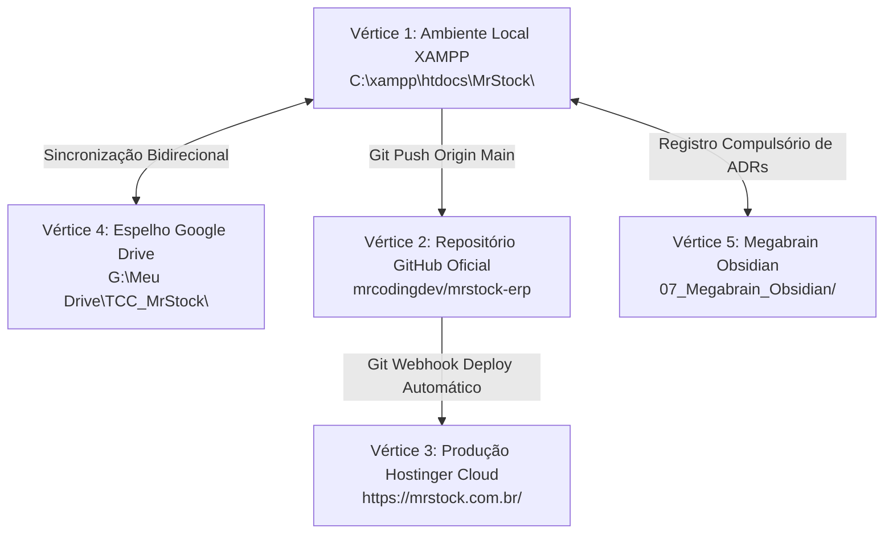

# Resumo Executivo e Arquitetural — MrStock ERP v2.2.0
## Sistema Integrado de Gestão Comercial, Controle de Estoque com Validades PEPS/FIFO e Frente de Caixa Ágil
### Edição Oficial: Papelaria Real Ltda (Sorocaba/SP)

---

## 1. Identificação Executiva do Projeto

O **MrStock ERP** é um ecossistema computacional de gestão comercial, controle de estoques e frente de caixa (Ponto de Venda - PDV) projetado e homologado para atender às demandas de varejo físico com alta rotatividade de itens e exigências de conformidade fiscal e sanitária.

```
┌────────────────────────────────────────────────────────────────────────────────────────┐
│                              FICHA DE IDENTIFICAÇÃO FORMAL                             │
├──────────────────────────┬─────────────────────────────────────────────────────────────┤
│ Sistema Homologado       │ MrStock ERP — Versão 2.2.0 (Edição Oficial Papelaria Real)   │
│ Natureza do Projeto      │ Trabalho de Conclusão de Curso (TCC)                        │
│ Instituição de Ensino    │ ETEC Fernando Prestes — Sorocaba/SP                         │
│ Órgão Mantenedor         │ Centro Estadual de Educação Tecnológica Paula Souza (CPS)   │
│ Curso Técnico            │ Habilitação Profissional Técnica em Desenvolvimento Sistemas│
│ Orientadores Acadêmicos  │ Prof. Luiz Flávio de Almeida e Prof. Vinicius Sewaybricker │
│ Ano Letivo e Semestre    │ 2026 — 2º Semestre (Ciclo de Homologação Final)             │
│ Empresa Beneficiária     │ Papelaria Real Ltda - ME (Estudo de Caso Piloto Oficial)    │
│ Fundação e Localização   │ 15/08/1981 — Rua XV de Novembro, 250 - Centro, Sorocaba/SP  │
│ Telefone Institucional   │ (15) 99644-1796                                             │
│ Sócios Fundadores        │ Sueli Aparecida e Osnir (45 anos de operação comercial)     │
└──────────────────────────┴─────────────────────────────────────────────────────────────┘
```

### Equipe de Engenharia e Matriz de Responsabilidades (Mr. Coding)
A concepção, projeto e desenvolvimento do sistema foram conduzidos pela equipe de engenharia **Mr. Coding**, sob uma divisão rigorosa de competências técnicas:

1. **Douglas Moraes Braz (Líder Técnico & Engenharia Full-Stack):**
   - Direção de arquitetura de software e governança de código.
   - Desenvolvimento Full-Stack em PHP 8.2 Nativo, modelagem de regras transacionais com PDO e implementação de segurança defensiva baseada no OWASP Top 10.
   - Construção do Design System Institucional MrStock e otimização para Core Web Vitals.
   - Configuração da infraestrutura de nuvem com deploy contínuo na Hostinger e ambiente de contingência local XAMPP.

2. **Nikolas Pires Brandão (Modelagem de Dados & DBA):**
   - Elaboração do Diagrama Entidade-Relacionamento (DER) e Dicionário de Dados formal.
   - Projeto físico do banco de dados `mrstock_db` com 14 tabelas relacionais em Terceira Forma Normal (3FN).
   - Definição de chaves estrangeiras com integridade referencial (`ON DELETE RESTRICT` / `CASCADE`), criação de índices estratégicos para buscas e implementação de controle de concorrência com Lock Pessimista.

3. **Cesar Augusto da Silva Junior (Engenharia de Requisitos & Interface Comercial):**
   - Condução do estudo de caso in loco na Papelaria Real, entrevistando fundadores e funcionários.
   - Aplicação de questionário estruturado de levantamento de requisitos de varejo físico.
   - Tradução dos gargalos comerciais em regras de negócio funcionais (CMP, travas de margem de lucro, fracionamento e controle de shelf-life).

4. **Enzo de Oliveira Soares (Documentação Técnica & Normas Acadêmicas):**
   - Coordenação dos relatórios acadêmicos, diagramas de caso de uso e especificações conforme as normas metodológicas da ABNT e do Centro Paula Souza.
   - Compilação do Manual do Usuário Oficial de 73 páginas e elaboração de atas de validação técnica.
   - Mapeamento das regras do Simples Nacional aplicadas ao comércio varejista de papelaria.

5. **Eduardo Sugahara Neto (Validação Operacional, QA & Navegação Live):**
   - Execução dos roteiros formais de Qualidade e Teste de Software (QTS), cobrindo as 24 telas do sistema.
   - Simulação de testes de estresse operacional de caixa (bipagem acelerada de itens e cálculo de troco sob pressão).
   - Operador oficial responsável pela demonstração da navegação em tempo real durante a sessão de defesa pública perante a banca examinadora da ETEC.

---

## 2. Contexto Mercadológico e Dores Reais do Comércio

O comércio varejista tradicional de papelarias de rua atua sob pressões mercadológicas singulares. A sazonalidade acentuada (como a alta demanda nos períodos de volta às aulas escolares em janeiro e fevereiro) convive com margens reduzidas em itens de consumo recorrente e um mix heterogêneo de produtos.

Durante a fase de diagnóstico na Papelaria Real Ltda, foram catalogadas seis dores operacionais e financeiras severas:

```
┌───────────────────────────────────────────────────────────────────────────────────────────────────┐
│                                 DIAGNÓSTICO DAS DORES COMERCIAIS                                  │
├──────────────────────────┬──────────────────────────────────────┬─────────────────────────────────┤
│ Gargalo Diagnosticado    │ Causa Raiz Operacional               │ Impacto Financeiro / Risco      │
├──────────────────────────┼──────────────────────────────────────┼─────────────────────────────────┤
│ 1. Lentidão em Filas de  │ Consulta manual de preços em folhas; │ Desistência de compra de        │
│    Balcão nos Picos      │ digitação morosa de descrições.      │ clientes; perda de faturamento. │
├──────────────────────────┼──────────────────────────────────────┼─────────────────────────────────┤
│ 2. Vencimento Silencioso │ Itens com shelf-life (colas, tintas, │ Descarte de mercadorias com     │
│    de Químicos/Líquidos  │ corretivos) sem controle de lotes.   │ perda total; risco no PROCON.   │
├──────────────────────────┼──────────────────────────────────────┼─────────────────────────────────┤
│ 3. Precificação Distor-  │ Compras recorrentes com oscilação de │ Margem mascarada; venda abaixo  │
│    cida sem CMP          │ preço sem recálculo ponderado.       │ do custo real de reposição.     │
├──────────────────────────┼──────────────────────────────────────┼─────────────────────────────────┤
│ 4. Vendas com Margem     │ Descontos manuais arbitrários        │ Prejuízo financeiro direto por  │
│    Negativa no PDV       │ concedidos no caixa sem validação.   │ quebra da margem de segurança.  │
├──────────────────────────┼──────────────────────────────────────┼─────────────────────────────────┤
│ 5. Ausência de Segrega-  │ Operador de caixa com visão plena de │ Exposição indevida do markup e  │
│    ção de Perfis (RBAC)  │ custos, lucros e relatórios.         │ risco de alterações indevidas.  │
├──────────────────────────┼──────────────────────────────────────┼─────────────────────────────────┤
│ 6. Fechamento Financeiro │ Apuração em calculadoras e cadernos; │ Erros de conciliação; desvios   │
│    Manual e Moroso       │ falta de relatório por meio de pago. │ não rastreados no caixa físico. │
└──────────────────────────┴──────────────────────────────────────┴─────────────────────────────────┘
```

A implantação do MrStock ERP substituiu procedimentos empíricos e anotações manuais por uma plataforma centralizada e de resposta instantânea, eliminando as vulnerabilidades de processo identificadas.

### Estruturação em 10 Famílias Funcionais de Produtos
Para eliminar categorias macro genéricas que inviabilizavam a busca e a organização no balcão, o catálogo do sistema foi modelado exclusivamente em torno das 10 famílias funcionais operadas pela Papelaria Real:
1. `Cadernos & Blocos`: Cadernos universitários, espirais, blocos de rascunho, agendas escolares e refis de fichário.
2. `Canetas & Marcadores`: Canetas esferográficas, ponta fina (fineliners), marcadores de texto, canetas em gel e marcadores permanentes.
3. `Lápis & Apontadores`: Lápis grafite de várias graduações (HB, 2B), lápis de cor aquareláveis, lapiseiras técnicas e apontadores com depósito.
4. `Borrachas & Correção`: Borrachas brancas escolares, borrachas técnicas para desenho, fitas corretivas e corretivos líquidos.
5. `Colas & Fitas Adesivas`: Colas brancas PVA, colas bastão, colas de silicone líquido, fitas crepe e fitas transparentes multiuso.
6. `Papéis & Folhas`: Resmas de papel sulfite A4 (75g/90g), cartolinas coloridas, papel vegetal, papel crepom e folhas pautadas.
7. `Pastas & Organização`: Pastas catálogo, pastas com aba e elástico, pastas sanfonadas, canaletas e organizadores de mesa.
8. `Corte & Medição`: Tesouras escolares sem ponta, estiletes de precisão, réguas rígidas de 30cm, esquadros e transferidores.
9. `Tintas & Pintura`: Tintas guache solúveis em água, tintas acrílicas para artesanato, pincéis chatos e redondos e paletas godê.
10. `Grampeadores & Fixação`: Grampeadores de mesa em aço, caixas de grampos 26/6, perfuradores de papel e clipes niquelados.

---

## 3. Pilha Tecnológica & Arquitetura de Software

A arquitetura do MrStock ERP foi concebida sob o paradigma da **Engenharia Cirúrgica**, priorizando independência de ecossistemas externos pesados, latência mínima no ponto de atendimento e facilidade de auditoria acadêmica.

```
┌───────────────────────────────────────────────────────────────────────────────────────────────────┐
│                                ARQUITETURA TECNOLÓGICA MRSTOCK                                    │
├───────────────────────────────────────────────────────────────────────────────────────────────────┤
│  CAMADA DE APRESENTAÇÃO (UI/UX)                                                                   │
│  • HTML5 Semântico • Bootstrap 5 Customizado Sólido (Zero Outline em Ações Principais)            │
│  • Tipografia Tabular Inter (Auto-hospedada) • Chart.js 4.4 Local • Ícones SVG FontAwesome 6     │
│  • Web Audio API Nativa (Síntese Pura de 880Hz / 280Hz sem Arquivos de Áudio Externos)            │
├───────────────────────────────────────────────────────────────────────────────────────────────────┤
│  CAMADA DE APLICAÇÃO (BACKEND)                                                                    │
│  • PHP 8.2 Nativo com Tipagem Estrita (`declare(strict_types=1);`)                                │
│  • Padrão MVC-lite com Modularização Funcional por Domínio                                        │
│  • Camada de Acesso a Dados via PDO (PHP Data Objects) com Prepared Statements Mandatórios        │
│  • Algoritmos Vetoriais Puros em SVG para Code 128B e QR Code (Isenção de Bibliotecas Externas)   │
├───────────────────────────────────────────────────────────────────────────────────────────────────┤
│  CAMADA DE PERSISTÊNCIA & DADOS                                                                   │
│  • MySQL 8.0 / MariaDB 10.4 com Storage Engine InnoDB                                             │
│  • 14 Tabelas Relacionais Normalizadas em 3FN com Chaves Estrangeiras Formais                      │
│  • Transações ACID com Lock Pessimista de Linha (`SELECT ... FOR UPDATE`) no Checkout             │
│  • Tipagem Numérica Monetária com Precisão Centesimal Estrita (`DECIMAL(10,2)`)                  │
└───────────────────────────────────────────────────────────────────────────────────────────────────┘
```

### Especificações Técnicas Fundamentais

1. **Processamento Backend e Latência de PDV:**
   - O uso de PHP 8.2 Nativo sem overhead de frameworks desacoplados confere ao PDV um tempo de resposta de processamento inferior a 15 milissegundos por requisição de bipagem, garantindo atendimento contínuo mesmo sob intensa carga transacional.

2. **Modelo Relacional Transacional ACID:**
   - Todas as operações de saída de mercadorias no PDV (`vendas/pdv.php`) e estornos no histórico (`vendas/historico.php`) operam dentro de blocos transacionais explícitos (`beginTransaction`, `commit`, `rollBack`).
   - O controle de concorrência é gerenciado por **Lock Pessimista** (`SELECT quantidade FROM produtos WHERE id = ? FOR UPDATE`), prevenindo a ocorrência de condições de corrida (*race conditions*) ou quebra de saldo em terminais operando simultaneamente.

3. **Cálculo Transacional do Custo Médio Ponderado (CMP):**
   - Ao registrar novas notas de fornecedores em `compras/nova.php`, o sistema aplica a equação do CMP para manter o valor contábil de reposição atualizado em tempo real:
     $$CMP_{\text{novo}} = \frac{(Q_{\text{atual}} \times C_{\text{atual}}) + (Q_{\text{comprada}} \times C_{\text{compra}})}{Q_{\text{atual}} + Q_{\text{comprada}}}$$

4. **Independência de CDNs e Componentes Vetoriais:**
   - O sistema elimina qualquer dependência de redes de distribuição de conteúdo (CDNs) externas. Fontes tipográficas, scripts e folhas de estilo estão localizados no servidor.
   - Os geradores de código de barras padrão Code 128B e de QR Code para a NFC-e didática foram implementados como rotinas matemáticas puras em PHP (`inc/barcode_helper.php`), sintetizando strings SVG diretamente no DOM sem recorrer a APIs ou serviços de terceiros.

5. **Sinalização Acústica via Web Audio API:**
   - A confirmação sonora de cada item adicionado ao carrinho do PDV utiliza a Web Audio API nativa do navegador. A oscilação senoidal pura a 880Hz (com ganho exponencial de 0.08 e duração de 60ms) fornece feedback tátil imediato ao operador, enquanto um tom descendente de 280Hz a 140Hz sinaliza alertas impeditivos.

---

## 4. Resiliência Operacional & Ambientes Híbridos

Para resguardar o comércio contra oscilações de conectividade à internet de banda larga, o MrStock ERP adota uma arquitetura híbrida de alta disponibilidade apoiada no **Pentágono Sagrado de Sincronização Contínua**:



### Protocolo de Contingência Offline
1. **Regime Principal em Nuvem:** Os operadores operam habitualmente através da URL pública `https://mrstock.com.br/`, hospedada em cluster Hostinger com certificado TLS 1.3 e balanceamento gerenciado.
2. **Queda de Conexão Banda Larga:** Diante de falhas no provedor externo de telecomunicações, o operador do caixa abre a instância local em `http://localhost/MrStock/`, executada sob a pilha XAMPP local.
3. **Continuidade Operacional:** As vendas, movimentações de estoque e emissões de comprovantes prosseguem sem interrupção de balcão. O restabelecimento da conectividade permite a conciliação assistida de registros via rotina de sincronismo do banco de dados.

---

## 5. Segurança Cibernética & Diretrizes OWASP

O desenvolvimento seguiu os preceitos de **Defesa em Profundidade** recomendados pela Open Web Application Security Project (OWASP):

- **Armazenamento de Senhas (ASVS V2.1):** Criptografia de senhas através do algoritmo BCrypt com fator de custo 12 (`PASSWORD_BCRYPT`, `['cost' => 12]`), impondo um atraso intencional no processamento que inviabiliza ataques de força bruta e tabelas rainbow.
- **Proteção contra Cross-Site Request Forgery (CSRF):** Todo formulário com método POST possui token criptográfico pseudoaleatório de 32 bytes gerado por `random_bytes(32)`, validado no backend de forma atômica via `hash_equals()`.
- **Prevenção contra SQL Injection (SQLi):** Erradicação de consultas dinâmicas concatenadas. 100% das leituras e escritas no banco utilizam Prepared Statements do PDO com binding explícito de parâmetros tipados.
- **Prevenção contra Cross-Site Scripting (XSS):** Sanitização rigorosa de qualquer variável refletida no HTML através de função padronizada `htmlspecialchars($var, ENT_QUOTES | ENT_SUBSTITUTE, 'UTF-8')`.
- **Cabeçalhos de Segurança HTTP Defensivos:** Emissão de headers de proteção no arquivo `config.php`:
  - `Content-Security-Policy`: Restringe a execução de scripts e estilos ao domínio local, mitigando injeção de scripts maliciosos.
  - `Strict-Transport-Security (HSTS)`: Força conexões HTTPS com validade estendida.
  - `X-Content-Type-Options: nosniff`: Bloqueia tentativas de farejamento de MIME type pelo navegador.
  - `X-Frame-Options: SAMEORIGIN`: Impede ataques de Clickjacking em iframes.
  - `Referrer-Policy: strict-origin-when-cross-origin`: Resguarda URLs e parâmetros internos.
- **Blindagem contra Reverse Tabnabbing:** Todo link externo direcionado para páginas secundárias ou suporte via WhatsApp implementa obrigatoriamente os atributos `target="_blank"` e `rel="noopener noreferrer"`.
- **Controle de Acesso Baseado em Perfis (RBAC):** Segregação estrita entre perfis `administrador` e `caixa`. Operadores com perfil caixa não possuem privilégio de acesso às rotas de faturamento, margem de lucro, DRE gerencial, compras e configurações estruturais da empresa.
- **Mecanismo de Backup SQL em 1-Clique:** Utilitário nativo em `configuracoes.php` capaz de efetuar o dump completo da estrutura DDL e registros DML das 14 tabelas com desativação temporária de chaves estrangeiras (`SET FOREIGN_KEY_CHECKS=0;`) para restauração íntegra.

---

## 6. Resultados Alcançados & Roadmap Futuro

A versão 2.2.0 atinge os critérios de validação acadêmica e homologação em ambiente real:

### Indicadores de Desempenho e Acessibilidade
- **Largest Contentful Paint (LCP):** 0,38 segundos na inicialização do PDV, dispensando telas de carregamento intermediárias.
- **Cumulative Layout Shift (CLS):** 0.000 devido à execução de script inline anti-FOUC (`Flash of Unstyled Content`) no cabeçalho do documento (`inc/header.php`), preservando o dimensionamento estável da barra lateral colapsável.
- **Acessibilidade Digital (WCAG 2.1):** Conformidade de contraste nível AAA na tela de autenticação e nível AA nos elementos interativos do PDV e relatórios, com suporte completo à navegação por teclado (`Tab`, `Enter`, `Esc`, `F1` a `F9`).
- **Precisão Financeira:** Colunas monetárias baseadas em `DECIMAL(10,2)` no MySQL e truncamento centesimal exato no frontend evitam discrepâncias comuns de representação de ponto flutuante binário.

### Roadmap Formal de Evolução — Versão 3.0 (Laravel 11)
Para a continuidade da pesquisa e evolução acadêmica nos termos aprovados pelos orientadores:
1. **Migração Arquitetural para Framework:** Adoção de Laravel 11 como evolução dos padrões consolidados nesta entrega em PHP Nativo.
2. **Camada de ORM e Migrations:** Transição do schema atual para migrações declarativas com Eloquent ORM.
3. **Módulo Fiscal em Nuvem Homologado:** Integração com APIs oficiais de emissão de NFC-e com transmissão síncrona e contingência offline em XML assinado digitalmente.
4. **Módulo de Fidelização Integrado:** Sistema de pontuação cumulativa vinculada ao CPF do consumidor cadastrado na Papelaria Real.
