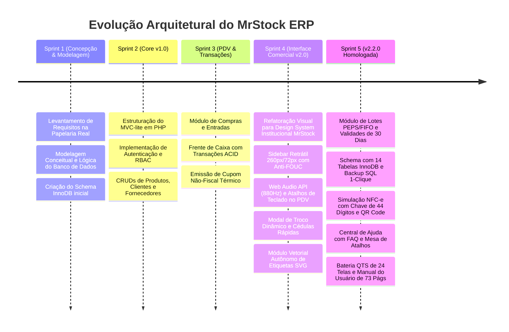

# Diário de Desenvolvimento & Histórico de Versões — MrStock ERP v2.2.0
**Instituição:** ETEC Fernando Prestes (Centro Paula Souza, Sorocaba/SP)  
**Orientadores Acadêmicos:** Prof. Luiz Flávio de Almeida e Prof. Vinicius Sewaybricker  
**Estudo de Caso Oficial:** Papelaria Real Ltda (Rua XV de Novembro, 250 - Sorocaba/SP | Tel: (15) 99644-1796)  

Este documento registra a linha do tempo, sprints de engenharia e a evolução arquitetural do **MrStock ERP** desde a concepção inicial até a homologação da **Versão 2.2.0 (Edição Oficial Papelaria Real)**.

---

## Linha do Tempo e Marcos do Projeto

---

## Detalhamento dos Sprints de Desenvolvimento

### Sprint 1: Fundação & Modelagem (Maio/2026)
- Visita técnica e levantamento de necessidades na Papelaria Real.
- Definição do escopo do TCC e aprovação da proposta pelos orientadores.
- Criação das 12 tabelas InnoDB relacionais com integridade referencial.

### Sprint 2: Lançamento da Versão 1.0 (Junho/2026)
- Criação do singleton de conexão PDO em `inc/database.php`.
- Implementação de autenticação com Bcrypt e isolamento de rotas em `inc/auth.php`.
- Desenvolvimento dos CRUDs de produtos, categorias, clientes e fornecedores.

### Sprint 3: Fechamento Transacional & Relatórios (Julho/2026)
- Criação do módulo de compras com cálculo automático de estoque.
- Implementação do PDV com bloqueio pessimista (`SELECT ... FOR UPDATE`).
- Geração de relatórios PDF e exportação para planilhas Excel em 9 colunas.

### Sprint 4: Versão 2.0 (Interface Comercial) (Agosto/2026)
- **Ergonomia do PDV:** Atalhos de teclado globais (`F2`-`F9`, `ESC`) e sintetizador sonoro de 880Hz via Web Audio API.
- **Troco Dinâmico:** Teclado numérico e botões de cédula de R$ 10 a R$ 200.
- **Etiquetas Vetoriais:** Geração autônoma de SVG Code-128 e EAN-13 em `inc/barcode_helper.php`.
- **Design System Institucional MrStock:** Sidebar com script Anti-FOUC no `<head>`, popover com `z-index: 99999` e paginação institucional verde.

### Sprint 5: Versão 2.2.0 Homologada & Encerramento do TCC (Setembro/2026)
- **Gestão de Lotes PEPS/FIFO:** Módulo `lotes/index.php` com cálculo de shelf-life, alerta de 30 dias para químicos e controle de capital imobilizado.
- **Schema Expandido para 14 Tabelas:** Consolidação das tabelas `lotes` e `configuracoes` com Backup SQL completo em 1-clique.
- **Painel Fiscal NFC-e Didático:** Simulação acadêmica de NFC-e (`vendas/nfce.php`) com Chave de Acesso de 44 dígitos e QR Code vetorial SVG.
- **Central de Ajuda & FAQ:** Módulo `ajuda.php` com FAQ operacional, tabela de teclas de atalho e roteiros passo a passo.
- **Homologação QTS & Documentação Final:** Aprovação formal nas 24 telas do sistema e consolidação do Manual do Usuário de 73 páginas.